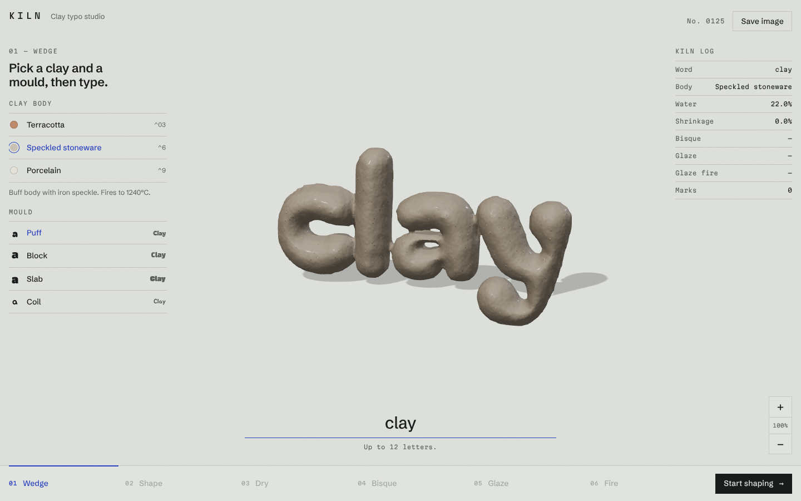

# KILN

A clay typo studio in the browser. Type a word and it is built out of clay: shape it with your hands, dry it, fire it, glaze it and fire it again.



## Install

No build step. Serve the folder over HTTP (it uses ES modules):

```sh
python3 -m http.server
```

Then open the printed address.

## Structure

```
index.html        the app
js/clay.js        the clay: a voxel signed distance field, sculpted and re-meshed live
js/material.js    clay, glaze and kiln-heat shading
js/main.js        scene, turntable, process steps and the kiln log
vendor/           Three.js
promo/            promo videos, rendered from the same clay engine
```
